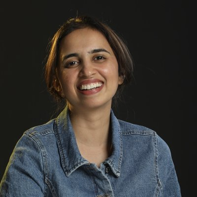

# Open Kannada

Kannada should be as easy to use on a computer as English.

Free, open-source tools for Kannada, at [openkannada.org](https://openkannada.org).

Years of Kannada documents were typed in old fonts that computers can't search or read aloud, and many everyday tools still handle Kannada badly. We build the missing pieces, test them on real text, and send our fixes to the fonts and programs people already use.

## Projects

- **[kannadi](https://github.com/openkannada/kannadi)**: convert documents typed in the old Nudi, Baraha, Nudi B-Akshara, Kan-Eng, Akruti and Shree-Lipi fonts to Unicode, and back. A Rust library, a command-line tool for whole folders of TXT, HTML, DOCX and PDF files, and an [editor that runs in your browser](https://openkannada.org/editor/).
- **[Neha Sans and Neha Serif](https://github.com/openkannada/noto-kannada-fork)**: our builds of Google's Noto Sans and Noto Serif Kannada, with shaping fixes and every weight. [Download v1.000](https://github.com/openkannada/noto-kannada-fork/releases/tag/v1.000).
- **[Gari](https://github.com/openkannada/gari-font)**: a handwriting-style Kannada font built on Aravinda VK's Navilu, with modern shaping and new letters. [Download v1.300](https://github.com/openkannada/gari-font/releases/tag/v1.300).
- **[English to Kannada dictionary](https://openkannada.org/dictionary/)**: look up an English word and get Kannada meanings, with Baraha spellings for typing.
- **[Spell check](https://openkannada.org/spell-check/)**: a Kannada dictionary for the spell checkers in LibreOffice, Firefox and other programs.
- **[OCR](https://openkannada.org/ocr/)**: reads old printed Kannada books more accurately than stock Tesseract.
- **[The Kannada token tax](https://openkannada.org/ai-benchmark/)**: how much more AI models charge to read the same text in Kannada than in English.

Upstream so far: Kannada conjunct and arkavattu checks in [shaperglot](https://github.com/googlefonts/shaperglot/pull/192), the tool Google Fonts uses to test language support.

## How you can help

- **Have an old Nudi, Baraha or Shree-Lipi file that converts wrongly?** Open an issue on kannadi with a short sample. Every fixed case becomes a test.
- **Read Kannada well?** Help check converted text against the original.
- **Design type?** Several open Kannada fonts are missing letters and heavier weights.
- **Write code?** Read [CONTRIBUTING](https://github.com/openkannada/.github/blob/main/CONTRIBUTING.md). Code is MIT OR Apache-2.0, fonts are OFL, and every commit is signed off.

## Who we are

&nbsp;&nbsp;

Open Kannada was started by [Prasad Subrahmanya](https://prasad.tech) and [Neha Prasad](https://neha-prasad.com/), its founding members, and is supported by [DataRavel Inc. (dba Luminik)](https://www.luminik.io).

Copyright stays with the authors, and the names belong to the project, not to DataRavel Inc.

Dedicated to [Veena and Subramanya](https://openkannada.org/about/#dedication).
